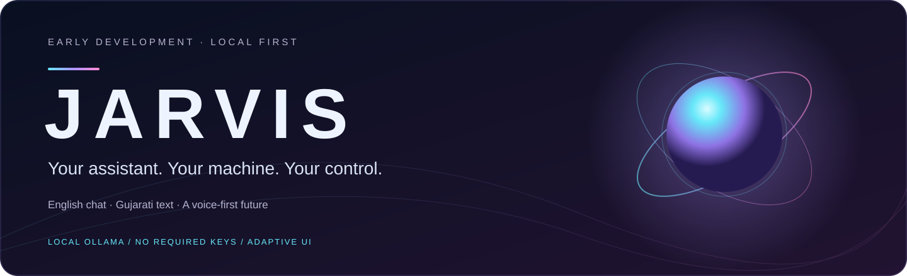
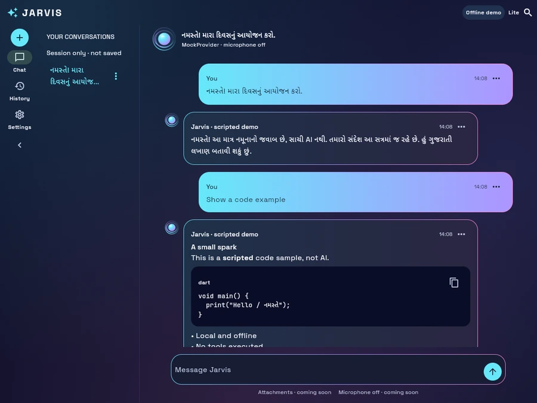
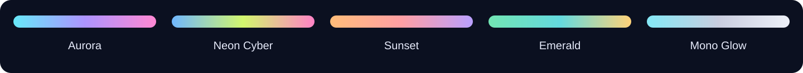
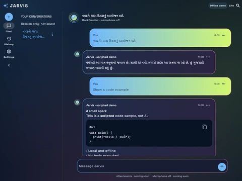
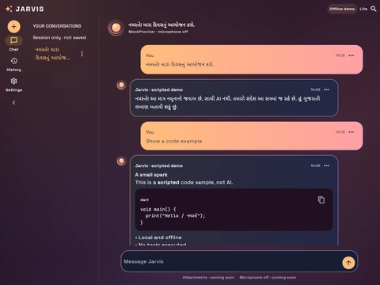
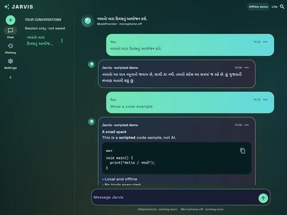
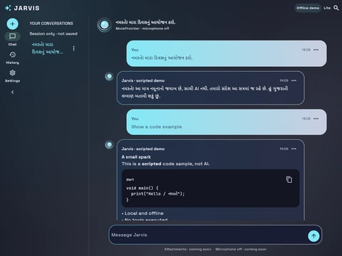
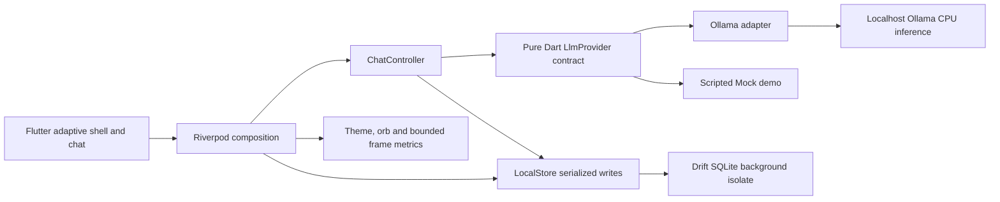

<div align="center">
  

  <p>A local-first Flutter assistant: English AI chat today, a voice-first future.</p>

  
  
  
  <br>
  
  
  

  <p><a href="#quick-start">Quick start</a> · <a href="#screenshots">Screenshots</a> · <a href="docs/PERFORMANCE.md">Measured performance</a> · <a href="docs/PLAN.md">Plan and Costs</a></p>
</div>

**Local Ollama chat works in English.** Gujarati input, display and lossless chat storage work; Gujarati AI answer quality is poor in the small models tested. Notes and tasks are planned and must preserve Gujarati text when delivered. Voice is planned; no microphone capture or spoken conversation is implemented yet. Project **licence to be decided**; no project licence has been selected.

<a id="contents"></a>
## 🧭 Contents

[What is JARVIS?](#what-is-jarvis) · [Screenshots](#screenshots) · [Features](#features) · [Architecture](#architecture) · [Quick start](#quick-start) · [Performance and hardware](#performance-and-hardware) · [Privacy and cost](#privacy-and-cost) · [Roadmap](#roadmap) · [Project structure](#project-structure) · [Credits and licences](#credits-and-licences)

<a id="what-is-jarvis"></a>
## ✨ What is JARVIS?

JARVIS brings a calm, adaptive interface to local assistance. It streams answers from your own Ollama installation, keeps chats and preferences in a local SQLite database, and offers five dark/light palettes with reduced motion and developer measurements. No paid API, cloud service, account or key is required to run the baseline after setup.

English is the working AI baseline. Gujarati text is supported through bundled fonts, Unicode input/rendering and tested lossless storage. Llama1b, Qwen2.5 1.5b and Qwen3 0.6b produced Gujarati script but failed simple Gujarati tasks: rambling, irrelevant replies or echoed instructions. Llama3b also failed the planning task. Script compliance is not fluent understanding. See the [measured replies and comparison](docs/PERFORMANCE.md).

Linux is built and tested. Windows has an **unverified, manual build workflow**. Android and iOS source is retained; current desktop chat connects only to localhost. Mobile Ollama needs future, explicitly configured access to a reachable user-owned host. Platform badges describe source targets, not completed platform certification.

<a id="screenshots"></a>
## 🎨 Screenshots

**These are real native Linux captures of the historical scripted Mock demo, not Ollama answers.** They use synthetic English/Gujarati text, Lite quality and reduced motion. Current local Ollama chat and persistent history are newer than these captures. Native Ollama screenshots could not be captured in the current restricted session; none have been fabricated.

<picture>
  <source media="(prefers-color-scheme: dark)" srcset="assets/readme/aurora-dark-demo.webp">
  <source media="(prefers-color-scheme: light)" srcset="assets/readme/aurora-light-demo.webp">
  
</picture>



| Aurora | Neon Cyber | Sunset | Emerald | Mono Glow |
|---|---|---|---|---|
|  |  |  |  |  |

Optimized previews are below 40 KB each; original captures and provenance remain in [the screenshot index](docs/screenshots/README.md) and [preview sources](assets/readme/SOURCES.json). Phone layouts are constrained native renders, not physical Android screenshots.

<a id="features"></a>
## 🛠️ Features

| Capability | Status | What actually works |
|---|---|---|
| Local English AI chat | ✅ Built on Linux | Ollama streaming, Stop aborts the request, typed errors/retry, 1b fast / 3b quality selection |
| Local chat history | ✅ Built on Linux | SQLite persistence, rename, confirmed chat deletion, English/Gujarati search and restart/migration tests |
| Gujarati text | ✅ Built | Fonts, input/rendering and lossless chat storage; temporary Unicode scratchpad |
| Gujarati AI conversation | 🚧 Limited quality | Small models tested are poor; no fluent-chat claim or silent cloud routing |
| Appearance and accessibility | ✅ Built | Five palettes, dark/light/system theme, adaptive layouts, app/OS reduced motion |
| Orb and Developer controls | ✅ Built | Visual states, Lite/Balanced/Ultra tiers, automatic fallback, overlay and per-tier frame timings; audio states are previews |
| Model and memory controls | ✅ Built | Context/output bounds, idle unload, resident-model guard, Linux RAM warning and app RSS |
| Windows / mobile | 🚧 Validation pending | Manual Windows CI not yet run; Android/iOS source, no current mobile LAN configuration |
| Notes, tasks, calendar and habits | 🗺️ Planned | Offline productivity with lossless Gujarati text; not implemented yet |
| English voice conversation | 🗺️ Planned | Engine comparison/approval first; push-to-talk, conversation mode and interruption later |
| Gujarati voice | 🗺️ Experimental later | Disabled until real audio evaluation; limited accuracy must be labeled honestly |
| Tools, memory, RAG, reminders | 🗺️ Planned | Local execution and permission boundaries; no active tool execution today |
| Gujarati cloud “smart mode” | 🗺️ Optional, planned | Off by default; explicit destination/data consent, separate account/key/cost approval; never required |

<a id="architecture"></a>
## 🧩 Architecture



Feature-first presentation/domain/data layers keep provider transport and storage out of domain contracts. Cancellation, timeouts and generation fences prevent late streams overwriting newer chats. Chat history is ordinary unencrypted SQLite. Future voice, tools and memory are design commitments, not nodes pretending to be implemented. Read [architecture decisions](docs/ARCHITECTURE.md).

<a id="quick-start"></a>
## 🚀 Quick start

Prerequisites: repository access, Flutter **3.47.7 / Dart 3.13.5**, the platform's Flutter desktop build toolchain, and sufficient storage. Linux desktop is the verified development path; no Android emulator is required. Initial SDK/package/SQLite setup needs internet. Check [Setup](docs/SETUP.md) and [Costs](docs/PLAN.md#costs) before installing tools or downloading models; single downloads above 1 GB require approval in this project's workflow.

```sh
git clone https://github.com/devpatel024/jarvis-ai.git
cd jarvis-ai
flutter pub get --enforce-lockfile
flutter analyze --no-pub
flutter test --no-pub
flutter run -d linux --no-pub
```

Install Ollama separately using its official desktop instructions; no automatic installer is embedded here. Its engine licence is MIT, while the models have separate terms. Once installed, start its service or run:

```sh
ollama serve
ollama list
```

<details>
<summary>Model setup, download limits and recovery</summary>

The reference machine already has both models; **do not pull them again**. On a fresh machine, review model licences and exact download sizes first. The observed 1b and 3b files exceed 1 GB, so obtain explicit download approval before using these setup commands:

```sh
ollama pull llama3.2:1b
ollama pull llama3.2:3b
```

Open Settings → Local intelligence → Check Ollama / model. Select 1b fast, 3b quality, or the clearly labeled Mock demo. The app only uses loopback, never downloads weights, and never routes to cloud. If another model is resident, stop it before retrying:

```sh
ollama ps
ollama stop MODEL
```

Chat keys: Enter sends, Shift+Enter inserts a newline, Esc stops, Ctrl+N starts a new chat, Ctrl+K opens commands. SQLite's first build fetches a small, hash-verified native asset; same-target builds were verified offline from cache. Removing caches or changing versions/platforms can require internet again.

</details>

<a id="performance-and-hardware"></a>
## 📊 Performance and hardware

Measured reference: Ubuntu 26.04, Intel i5-6300U (2 cores / 4 threads), 8 GB RAM, Intel HD 520 integrated graphics, no dedicated GPU, 256 GB target disk. CPU inference uses two threads, context 2048 and a 256-token output cap. One model runs at a time and idle models unload. Existing desktop load was uncontrolled; these small samples are not performance guarantees.

**English Ollama results** (one greeting cold, one planning prompt warm per model):

| Model | Tokens/sec greeting / planning | First token cold / warm | Peak Ollama process RSS |
|---|---:|---:|---:|
| llama3.2:1b · fast default | 3.35 / 3.34 | 12.75 / 1.34 s | 1.40 GiB |
| llama3.2:3b · quality option | 2.08 / 1.88 | 33.17 / 4.02 s | 2.22 GiB |

**Gujarati-only matched rerun:** Llama1b 3.78–3.89 tokens/sec, Qwen2.5 4.74–4.75, Qwen3 9.89–10.19. All used Gujarati script, but none completed both tasks usefully. Qwen3's speed reflects short echoed instructions, not successful answers. Defaults remain 1b/3b; Qwen models were comparison-only. Full first-token/RAM/quality measurements and raw replies are in [PERFORMANCE](docs/PERFORMANCE.md).

<details>
<summary>Orb tiers, frame evidence and practical limits</summary>

| Profile tier | Build p95 | Raster p95 | What to expect |
|---|---:|---:|---|
| Ultra | 33.31 ms | 90.15 ms | Manual richer visuals; expensive on HD 520 |
| Balanced | 32.48 ms | 85.21 ms | Intermediate visuals |
| Lite | 33.02 ms | 84.88 ms | Conservative automatic start; reduced motion stops the pulse |

The measured **30/60fps targets are not met**. These are whole-app engine timings, not isolated painter costs or wall-clock FPS. Settings → Developer exposes the overlay and bounded per-tier readouts for your own measurements. Linux uses Skia after observed Impeller stalls; other-platform graphics behavior is unverified. Peak app RSS in the earlier profile run was 223.6 MiB, separate from Ollama process RSS. Native windows request about 1280×800, capped to usable monitor area, with about 360×640 minimum where the screen permits; OS compositor rules can override geometry hints.

Large histories currently load fully and use snapshot writes. No background indexing runs during chat. Model file sizes differ from RAM use. Expect slow cold starts and poor Gujarati generation. Linux is tested; Windows requires its manual CI run, Android needs physical-device validation, and iOS needs macOS tooling.

</details>

<a id="privacy-and-cost"></a>
## 🔒 Privacy and cost promise

The baseline runs locally after setup: no paid API, required account/key, telemetry, cloud backend, hosted database or sync. Chat requests go only to localhost Ollama. The app does not silently download models or record audio; voice is not implemented. Chats and settings are saved locally in **unencrypted SQLite**, protected by OS account/file permissions. Logical chat deletion is not forensic erasure; export and full app-data deletion remain planned.

$0 refers to baseline software/service charges. Hardware, electricity, storage and initial connectivity still cost resources; signing/store distribution may cost money. Optional future cloud Gujarati smart mode may require accounts/keys and variable charges, stays off by default, and requires explicit consent before sending personal context. No provider or free tier has been adopted. Full package, native artifact and font terms are in [Costs](docs/PLAN.md#costs).

<a id="roadmap"></a>
## 🗺️ Roadmap

| Phase | Status | Deliverable |
|---|---|---|
| 0 / 1a / 1b / 1b.2 / Slice A | ✅ Delivered | Planning, shell, orb/Mock chat, developer controls and visual polish |
| Part 2 / Phase 2 | 🚧 Desktop core built | Local Ollama and persistence; mobile LAN/richer onboarding still open |
| Part 3 | ✅ README delivered | Honest project page, previews and runner size bounds; Windows sizing unverified |
| 1b.3 | 🗺️ Approval gate | English offline speech engines compared before voice integration |
| 1c | 🗺️ Not started | Broader tests and CI; narrow SQLite Windows workflow exists separately |
| 3–4 | 🗺️ Planned | Notes/tasks/calendar/habits and reminders, lossless Gujarati text |
| 5 | 🗺️ Planned | Broader speech evaluation; Gujarati experimental only after real samples |
| 6–7 | 🗺️ Planned | Confirmed memory, export/deletion, document/image RAG |
| 8–10 | 🗺️ Planned | Permissioned tools, desktop integration and physical mobile validation |
| 11–12 | 🗺️ Planned | Opt-in automation, reliability and release validation |
| 13 | 🗺️ Optional | Consent-based Gujarati cloud smart mode, off by default; costs/accounts separate |

The authoritative [PLAN](docs/PLAN.md) owns phase gates. “Next” never approves new dependencies, restricted licences or downloads. Wake word is not part of the current voice step.

<a id="project-structure"></a>
## 🗂️ Project structure

<details>
<summary>Source map and development records</summary>

```text
lib/
  app/                       bootstrap composition and themes
  core/                      design, developer metrics, storage
  features/chat/             presentation / domain / data
  features/orb/              lightweight visual core
  features/shell/            adaptive navigation
test/                        provider, persistence, widgets and fakes
tool/                        benchmark and capture harnesses
linux/ windows/ android/ ios/ native runners
assets/                      fonts, notices and README previews
docs/                        plan, handoff, setup and measured evidence
```

Start with [AGENTS](AGENTS.md), [Setup](docs/SETUP.md), [Architecture](docs/ARCHITECTURE.md), [Plan and Costs](docs/PLAN.md), [Handoff](docs/HANDOFF.md), [Performance](docs/PERFORMANCE.md) and [screenshots](docs/screenshots/README.md). Generated Drift source is committed. Windows CI is manual and quota-conscious; runnable unsigned packages differ from signed/store-ready releases.

</details>

<a id="credits-and-licences"></a>
## 💜 Credits and licences

**Project licence to be decided.** Third-party licences do not select a licence for this repository; no project LICENSE file has been added.

| Component | Pinned version | Terms / notices |
|---|---|---|
| Flutter / Dart | 3.47.7 / 3.13.5 | SDK BSD notices and third-party terms |
| flutter_riverpod / flutter_lints | 3.4.3 / 6.0.0 | MIT / BSD-3-Clause |
| Drift / sqlite3 / path_provider | 2.35.2 / 3.7.0 / 2.1.6 | MIT / MIT + public-domain native SQLite / BSD-3-Clause |
| Ollama / Llama weights | 0.40.3 / observed manifest pins | MIT engine; Llama 3.2 Community License + AUP for weights, not bundled |
| Space Grotesk / Noto Sans Gujarati / JetBrains Mono | 2.000 / 2.106 / 2.211 | Approved SIL OFL 1.1; bundled notices |
| README banner / palette strip | Original repository assets | No external logo or image source; project licence undecided |

Fonts: [source pins](assets/fonts/SOURCES.json), [Space Grotesk notice](assets/fonts/SpaceGrotesk-OFL.txt), [Gujarati notice](assets/fonts/NotoSansGujarati-OFL.txt), [JetBrains Mono notice](assets/fonts/JetBrainsMono-OFL.txt). [JNI native notice](assets/licenses/JNI-NATIVE.txt). Every resolved package and native SQLite download/hash is recorded in [Costs](docs/PLAN.md#costs). Speech candidates are proposals only until approval; model and voice licences are reviewed independently.
